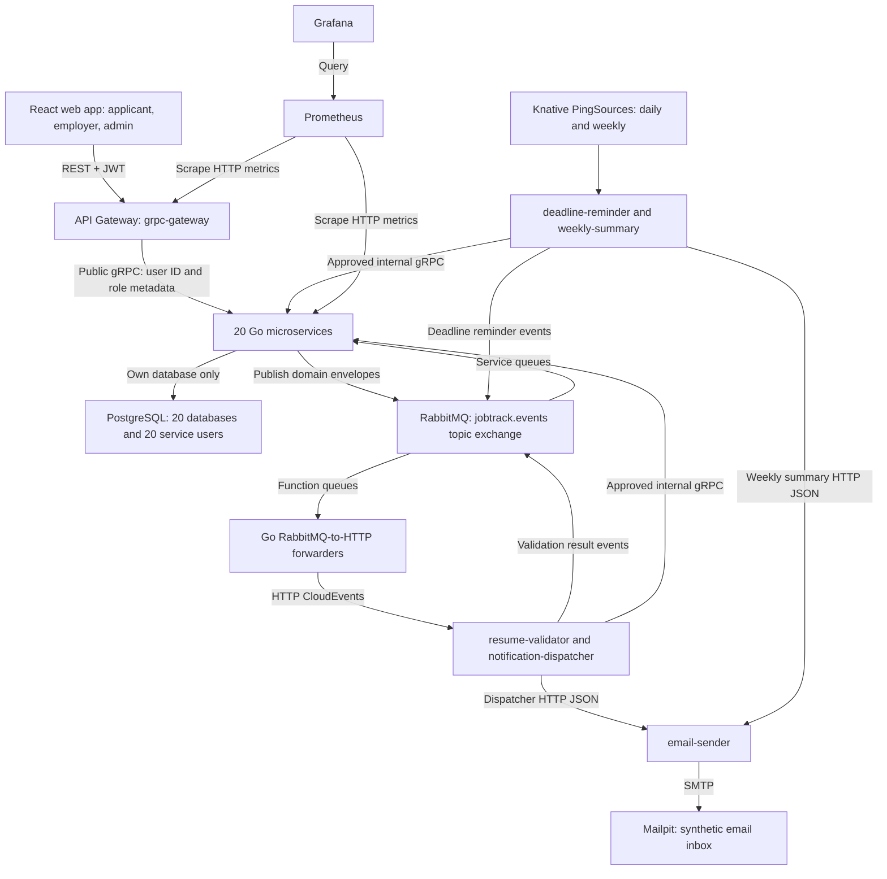

# JobTrack system architecture (JT-94)

This is a navigation and architecture reference for the repository as inspected on
19 November 2026. [AGENTS.md Sections 3–6](../../AGENTS.md) remain authoritative;
these tables describe the agreed responsibilities, not proof that every consumer
or deployment is operational. See the [run guide](../deployment/how-to-run.md)
for execution, verification and deployment gaps.

## System boundary and diagram

Applicants, employers and admins use the React/TypeScript/MUI frontend. Its shared
API client calls only the Go grpc-gateway using REST and JWT. The gateway routes
public RPCs to 20 Go microservices. Each service follows hexagonal architecture:
domain rules, app use cases and ports, with gRPC/PostgreSQL/RabbitMQ adapters.
The reference `services/service-template/` and `gateway/` are outside the count of 20.
Gateway owner: Jigden Shakya; backup: Sangay Tenzin.



Arrows show the agreed logical flows, not an implemented network bridge. Function
groups label their specific publishing/calling member on each edge. In Compose,
functions are ordinary HTTP containers in the opt-in `functions` profile; there
is no Knative or scale to zero, and schedules are invoked manually. In the agreed
WEB303 deployment, services stay in Compose and all five functions run on Knative
in k3d; official assessment-scope confirmation is still open (AGENTS.md Section 16).
Cross-network connectivity and missing trigger wiring remain deployment work.

## Services, ownership, data and events

Folders are `services/<service>/`. The database **and user** have the snake_case
name shown below, created by
[the PostgreSQL init script](../../deploy/compose/postgres-init/01-create-service-databases.sh).
One PostgreSQL server hosts them; no service reads another service's database.
Functions, gateway and frontend have no service database. Owners below are the
Section 4 owners; sprint task reassignments do not change ownership. Team A is
Phuntsho Namgyel and Kinley Tobgay Lhendrup; Team B is Jigden Shakya and Sangay
Tenzin. The tables use their short names, as in AGENTS.md.

| # | Service | Owner | Database and user | Responsibility | Publishes | Consumes |
|---|---|---|---|---|---|---|
| 1 | `auth` | Jigden | `auth` | Register, login, issue JWT, user lookup (name, email, role) | `user.registered` |  |
| 2 | `employer` | Jigden | `employer` | Company profiles, verified flag |  | `employer.verified`, `employer.verification_rejected` |
| 3 | `company-verification` | Jigden | `company_verification` | Verification requests and admin decisions | `employer.verified`, `employer.verification_rejected` |  |
| 4 | `moderation` | Jigden | `moderation` | Reports on job postings, admin takedowns | `moderation.job_removed` |  |
| 5 | `audit-log` | Jigden | `audit_log` | Records key actions from all events (admin view) |  | all events |
| 6 | `analytics` | Jigden | `analytics` | Outcome statistics built from events |  | `job.published`, `job.closed`, `application.submitted`, `application.withdrawn`, `application.status_changed`, `offer.made`, `offer.accepted`, `offer.declined` |
| 7 | `job-posting` | Sangay | `job_posting` | Create, edit, publish and close vacancies | `job.published`, `job.updated`, `job.closed` (also on moderation removal) | `moderation.job_removed` |
| 8 | `category-tag` | Jigden | `category_tag` | Categories, skill tags, locations (seeded, read-only) |  |  |
| 9 | `job-search` | Sangay | `job_search` | Search read model built from job events |  | `job.published`, `job.updated`, `job.closed` |
| 10 | `saved-jobs` | Sangay | `saved_jobs` | Bookmarks |  | `job.closed` |
| 11 | `notification-inbox` | Sangay | `notification_inbox` | Stores and lists in-app notifications, mark as read |  | (written by Notification Dispatcher via gRPC) |
| 12 | `applicant-profile` | Kinley | `applicant_profile` | Applicant details, education, skills |  |  |
| 13 | `resume` | Kinley | `resume` | Upload and store resumes (in its database, 2 MB limit), validation status | `resume.uploaded` | `resume.validated`, `resume.rejected` |
| 14 | `application-status` | Kinley | `application_status` | Status lifecycle state machine and history | `application.status_changed` | `application.submitted`, `application.withdrawn`, `review.completed`, `interview.scheduled`, `offer.made`, `offer.accepted`, `offer.declined` |
| 15 | `review` | Kinley | `review` | Employer scores and shortlist decisions | `review.completed` | `application.submitted` |
| 16 | `interview` | Kinley | `interview` | Schedule and record interviews | `interview.scheduled` | `application.submitted` |
| 17 | `application` | Phuntsho | `application` | Submit and withdraw applications, eligibility checks | `application.submitted`, `application.withdrawn` |  |
| 18 | `offer` | Phuntsho | `offer` | Offers; applicant accepts or declines | `offer.made`, `offer.accepted`, `offer.declined` | `application.submitted` |
| 19 | `messaging` | Phuntsho | `messaging` | Message threads per application | `message.sent` | `application.submitted` |
| 20 | `job-alert` | Phuntsho | `job_alert` | Applicant subscriptions; matches new jobs | `job_alert.matched` | `job.published` |

Blank event cells mean no event responsibility assigned in Section 4. Notification
Inbox is written by the dispatcher through gRPC, not a RabbitMQ subscription.
`audit-log` consuming all events is the agreed architecture; verify implemented
consumers against their task evidence before demonstrating it.

## Functions and triggers

Folders are `functions/<function>/`. There are five functions. The Section 3
shorthand “3 event-driven, 2 scheduled” includes email-sender among the three
nonscheduled functions; Section 5 specifies that it takes direct HTTP JSON,
not a RabbitMQ CloudEvent.

| Function (folder) | Owner | Trigger | Responsibility |
|---|---|---|---|
| `notification-dispatcher` | Sangay | Events: `application.submitted`, `application.status_changed`, `interview.scheduled`, `offer.made`, `message.sent`, `job_alert.matched`, `employer.verified`, `deadline.reminder` | Decides who is notified and how. Writes to Notification Inbox (gRPC) and calls Email Sender for emails. Gets user emails from Auth. |
| `email-sender` | Sangay | Direct HTTP JSON call from other functions | Sends email through SMTP to Mailpit; [shared HTTP contract](../deployment/email-sender-http-contract.md) |
| `weekly-summary` | Jigden | Weekly schedule (PingSource) | Gets statistics from Analytics and admin emails from Auth, then emails a summary to admins. |
| `resume-validator` | Phuntsho | Event: `resume.uploaded` | Fetches the file from Resume, checks type (PDF only), size (max 2 MB) and content signature. Publishes `resume.validated` or `resume.rejected`. |
| `deadline-reminder` | Kinley | Daily schedule (PingSource) | Finds jobs closing within 48 hours (Job Posting) and who saved them (Saved Jobs). Publishes `deadline.reminder` events. |

The weekly PingSource is Monday 08:00 and the daily PingSource is 07:00, both
`Asia/Thimphu`, in the checked-in manifests. Event functions receive the complete
protojson domain envelope as binary CloudEvent data. Email-sender instead accepts
`POST /send-email` JSON; see its linked contract for timeouts, retry uncertainty
and possible duplicate emails.

## Event delivery and main flows

The durable topic exchange is `jobtrack.events`; routing key equals event type.
The envelope fields are `event_id` (UUID), `type`, `occurred_at`, `producer` and
`data`, defined in [events.proto](../../proto/jobtrack/events/v1/events.proto).
Each consuming service owns a durable `<service>.<purpose>` queue. Database changes
and outgoing events belong in one transaction via an outbox; consumers record
`processed_events.event_id` in the same transaction as the state change.

The [JT-61 forwarder](../deployment/jt-61-forwarder.md) preserves the envelope and
maps event ID/type to CloudEvent headers. Each event-driven function is assigned
`<function>.events` and `<function>.events.dead` quorum queues. The source sets `x-delivery-limit=3`,
`x-dead-letter-strategy=at-least-once`, `x-overflow=reject-publish` and routes to its
dead queue. One HTTP attempt per delivery gives at most four attempts, with
1/2/4 second backoff before redeliveries. Broker counts survive reconnects and
restarts; crashes can consume the budget without a completed request. Only HTTP
2xx is acknowledged. HTTP failures use `basic.reject(requeue=true)`; malformed or
exhausted deliveries use `basic.nack(requeue=false)`. The source retains dead
letters until the destination confirms them. Forwarders carry no internal gRPC
credentials; only the functions calling internal RPCs receive `INTERNAL_TOKEN`.
Success followed by an uncertain ACK can duplicate processing, so event-ID deduplication is required. Never automatically
delete classic queues or data to resolve a quorum-topology mismatch; DevOps must
review migration. The diagram does not assert that every forwarder is wired today.

1. **Verification and publishing:** company-verification emits `employer.verified`
   or `employer.verification_rejected`; employer updates its flag. Publishing calls
   Employer to check verification, then emits `job.published`. Job Search builds
   its read model, Job Alert matches subscriptions and emits `job_alert.matched`,
   and Analytics/Audit Log record their assigned events.
2. **Resume and application:** Resume stores PENDING and emits `resume.uploaded`.
   The validator fetches the file through internal gRPC, checks PDF type, signature
   and size (max 2,000,000 bytes), then emits `resume.validated` or `resume.rejected`.
   Resume updates its record. Application synchronously checks the open job/deadline
   and validated resume ownership before saving and emitting `application.submitted`.
   Application Status creates SUBMITTED; Review, Interview, Offer and Messaging
   establish their local application context; the dispatcher notifies participants.
3. **Hiring:** Review, Interview and Offer publish the events in the tables above.
   Application Status owns transitions and history and emits
   `application.status_changed`; an invalid transition is `FAILED_PRECONDITION`.
   The applicant can withdraw a non-final application, emitting
   `application.withdrawn`. No distributed atomic commit is implied by this saga.
4. **Moderation and closing:** `moderation.job_removed` removes the job. Job Posting
   emits `job.closed` when the removed job was published; an already closed job
   does not emit it again and a draft was never published (AGENTS.md JT-90 decision).
   Job Search and Saved Jobs consume closure events; Analytics counts closures.
5. **Schedules and communication:** Deadline Reminder reads closing jobs and savers,
   emits `deadline.reminder`, and the dispatcher writes notifications and calls
   Email Sender. Weekly Summary reads statistics/admins and calls Email Sender.
   Messaging emits `message.sent`; dispatcher handles the notification.

```text
SUBMITTED -> UNDER_REVIEW -> SHORTLISTED -> INTERVIEW -> OFFERED -> ACCEPTED
                                                               \-> DECLINED
REJECTED: from SUBMITTED, UNDER_REVIEW, SHORTLISTED or INTERVIEW
WITHDRAWN: from any non-final state
Final: ACCEPTED, DECLINED, REJECTED, WITHDRAWN
```

Every transition is stored in history and publishes `application.status_changed`.
Read models converge asynchronously; allow event processing between UI steps.

## Approved synchronous gRPC calls

| Caller | Calls | RPC | Why | Cross-team |
|---|---|---|---|---|
| `gateway` | all services | Public services only (RPCs with HTTP annotations) | Frontend requests | Yes |
| `application` | `job-posting` | `JobPostingService.GetJob` (forwards user identity) | Job open check | Yes |
| `application` | `resume` | `ResumeService.GetResume` (forwards user identity) | Resume validated check | No |
| `job-posting` | `employer` | `EmployerService.GetCompanyProfile` (forwards user identity) | Employer verified check | No |
| `job-alert` | `category-tag` | `CategoryTagInternalService.ResolveNames` | Validate category/tag IDs and resolve their names | Yes |
| `notification-dispatcher` | `notification-inbox`, `auth` | `NotificationInboxInternalService.CreateNotification`, `AuthInternalService.GetUser` | Write notification, get email | No |
| `weekly-summary` | `analytics` | `AnalyticsInternalService.GetInternalSummary` | Statistics | No |
| `weekly-summary` | `auth` | `AuthInternalService.ListUsersByRole` | Admin emails | No |
| `deadline-reminder` | `job-posting`, `saved-jobs` | `JobPostingInternalService.ListJobsClosingBetween`, `SavedJobsInternalService.ListJobSavers` | Closing jobs and who saved them | Yes |
| `resume-validator` | `resume` | `ResumeInternalService.GetResumeFile` | Fetch file | No |

Any new synchronous call must be agreed by both teams and added to AGENTS.md
Section 6.

Email Sender's direct HTTP API is the Section 5 exception for function-to-function
email delivery. All outgoing gRPC calls use `pkg/grpcclient` for a default 2 s
timeout, up to three retries on `UNAVAILABLE`, and a circuit breaker. Public calls
on behalf of a user forward incoming `x-user-id` and `x-user-role` metadata.

## Identity and all three internal-call security layers

The gateway verifies HS256 JWTs using `JWT_SECRET` (at least 32 bytes): valid
signature, issuer `jobtrack-auth`, expiry and known role. Auth issues one-hour
tokens (`sub`, `role`, `iss`, `iat`, `exp`); no refresh tokens. Register/login and
allowed CORS preflights are exceptions to JWT checks; `/healthz` and `/metrics`
are also open. The gateway removes client-supplied `x-user-*`, `x-internal-*` and `x-caller-*`, then sets user ID from
`sub` and role from `role`. Public handlers still enforce role/ownership through
`pkg/authctx`. The gateway rejects bodies over 3 MiB with HTTP 413.

1. **Contract:** public `<Name>Service` RPCs have HTTP annotations. Internal RPCs
   live only in separate `<Name>InternalService` definitions with no HTTP annotations;
   the gateway never registers them. Internal calls have no end-user role check.
2. **Application:** internal callers use
   `grpcclient.InternalUnaryClientInterceptor(INTERNAL_TOKEN, SERVICE_NAME)`.
   Servers wire `authctx.InternalUnaryServerInterceptor(INTERNAL_TOKEN)`. Exactly
   one `x-internal-token` and one `x-caller-service` are required. Token hashes are
   compared in constant time; missing/wrong tokens return `UNAUTHENTICATED`,
   disallowed callers return `PERMISSION_DENIED`, and unknown internal RPCs are
   denied. Only callers in the approved table are accepted. Startup rejects an
   empty token or anything except visible ASCII without whitespace. The client
   replaces outgoing internal credentials, strips them on public calls and never
   copies incoming security metadata. Gateway/frontend never receive the token;
   public-only callers use `grpcclient.UnaryClientInterceptor()`.
3. **Network:** the intended k3d NetworkPolicy per service admits port 9090 only
   from approved callers, including the intended Knative pods. These manifests
   remain pending. Compose never publishes service gRPC 9090 to the host;
   Compose network membership alone does not provide a per-caller allowlist.

Layer 1 is in place. JT-44 supplies layer 2 helpers, but protection is active only
where service owners wire them. AGENTS.md Section 16 records adoption and the
Saved Jobs `ListJobSavers` interceptor/pagination gaps; inspect before relying on
protection. `deploy/k8s/` currently holds only the reference service manifests,
not a complete service deployment or NetworkPolicy set. The shared token holder
can impersonate another caller; `x-caller-service` alone proves no identity.
Full service identity via mTLS is out of scope; this residual risk is accepted
in AGENTS.md. Do not describe planned network isolation as deployed security.
