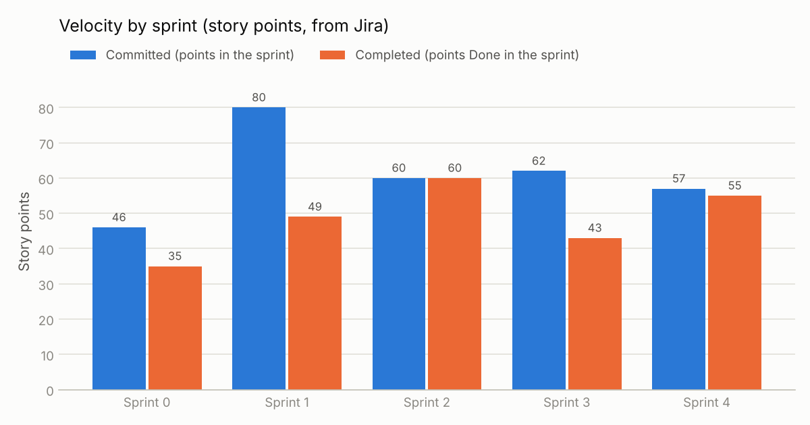
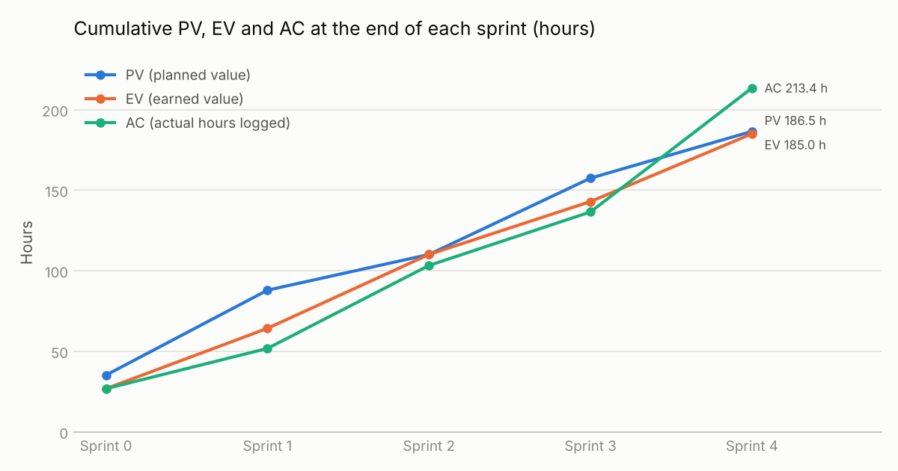

# JobTrack: Earned Value Report

| Item | Detail |
|---|---|
| Jira task | JT-100 |
| Prepared by | Jigden Shakya (Scrum Master and project manager). Backup: Kinley Tobgay Lhendrup |
| Version | 1.0 |
| Date | 20 Nov 2026 |
| Data source | Jira space JT (jobtrack-cst.atlassian.net): story points, sprint membership, status and logged time of all 94 issues, read on 20 Nov 2026 at 17:15 |
| Related documents | `docs/pm/project-closure-report.md`, `docs/pm/sprint-4-review.md`, `docs/pm/project-charter.md` (Section 8), `docs/pm/definition-of-done.md` (time logging) |

---

## 1. Purpose

The charter (Section 2, O4) asks for earned value calculated from Jira time logs. This report gives planned value (PV), earned value (EV), actual cost (AC), schedule and cost variance (SV, CV) and the schedule and cost performance indexes (SPI, CPI) at the end of every sprint from Sprint 0 to Sprint 4, with a short interpretation.

---

## 2. Method

The project uses agile earned value: value is measured in story points and cost in hours logged in Jira. There is no money budget (charter Section 8).

| Term | How it is measured |
|---|---|
| Scope (BAC) | Every estimated Jira issue in Sprints 0 to 4: 85 issues, 244 story points |
| PV | Cumulative story points of the work planned by the end of each sprint. Each issue counts once, in the sprint where it was first planned; carried-over work is not counted again |
| EV | Cumulative story points of the issues Done at the end of each sprint. JT-100 is counted as Done in Sprint 4, because this report is its final deliverable and it is Done when its pull request merges |
| AC | Cumulative hours logged in Jira. Each issue's hours count in the last sprint it belonged to. Every carried-over issue has a single worklog dated in the sprint where it was finished (checked for all 21 carried issues), so this matches when the hours were logged. JT-53 and JT-65 (outside any sprint) count in Sprint 2 and JT-109 in Sprint 4, by their worklog dates |
| Unestimated work | Bugs without points and JT-109 add hours to AC but no points to EV, because they were not in the planned scope |

Cost baseline. The team never set planned hours: Jira has no original estimates, and the working agreement and sprint plans give only story points. The cost baseline is therefore the rate measured in Sprint 0, the first sprint, applied to all later work (agreed by Jigden on 20 Nov 2026 for JT-100):

- Planned rate = Sprint 0 hours / Sprint 0 points Done = 26.8 h / 35 points = 0.764 hours per point
- PV and EV in hours = story points x 0.764
- Budget at completion (BAC) = 244 points x 0.764 = 186.5 hours

Formulas: SV = EV - PV, CV = EV - AC, SPI = EV / PV, CPI = EV / AC. Because the baseline comes from Sprint 0, Sprint 0 has a CPI of 1.00 by definition.

---

## 3. Per sprint (from Jira)

| Sprint | Dates | Committed points | First planned in this sprint | Points Done | Hours logged | Hours per point Done | Hours on unestimated work |
|---|---|---|---|---|---|---|---|
| Sprint 0 | 2 to 3 Nov | 46 | 46 | 35 | 26.8 | 0.76 | 0.0 |
| Sprint 1 | 6 to 8 Nov | 80 | 69 | 49 | 25.0 | 0.51 | 0.0 |
| Sprint 2 | 9 to 13 Nov | 60 | 29 | 60 | 51.5 | 0.86 | 2.7 |
| Sprint 3 | 14 to 16 Nov | 62 | 62 | 43 | 33.2 | 0.77 | 0.0 |
| Sprint 4 | 17 to 20 Nov | 57 | 38 | 55 | 77.0 | 1.40 | 12.6 |
| Total | 2 to 20 Nov | | 244 | 242 | 213.4 | 0.88 | 15.3 |

"Committed" counts every issue in the sprint, including carried-over work; "first planned" counts only new work and is the basis of PV.

---

## 4. Earned value at the end of each sprint (cumulative)

Story points:

| End of | PV (points) | EV (points) | SV (points) | SPI |
|---|---|---|---|---|
| Sprint 0 | 46 | 35 | -11 | 0.76 |
| Sprint 1 | 115 | 84 | -31 | 0.73 |
| Sprint 2 | 144 | 144 | 0 | 1.00 |
| Sprint 3 | 206 | 187 | -19 | 0.91 |
| Sprint 4 | 244 | 242 | -2 | 0.99 |

Hours (points x 0.764):

| End of | PV (h) | EV (h) | AC (h) | SV (h) | CV (h) | SPI | CPI |
|---|---|---|---|---|---|---|---|
| Sprint 0 | 35.2 | 26.8 | 26.8 | -8.4 | 0 | 0.76 | 1.00 |
| Sprint 1 | 87.9 | 64.2 | 51.7 | -23.7 | +12.5 | 0.73 | 1.24 |
| Sprint 2 | 110.1 | 110.1 | 103.3 | 0 | +6.8 | 1.00 | 1.07 |
| Sprint 3 | 157.4 | 142.9 | 136.5 | -14.5 | +6.5 | 0.91 | 1.05 |
| Sprint 4 | 186.5 | 185.0 | 213.4 | -1.5 | -28.5 | 0.99 | 0.87 |

At completion:

| Measure | Value |
|---|---|
| BAC | 244 points, 186.5 h |
| EV | 242 points, 185.0 h (only JT-72, 2 points, not delivered) |
| AC | 213.4 h |
| SPI | 0.99 |
| CPI | 0.87 |
| Variance at completion (BAC - AC) | -26.9 h |
| Finish date | 20 Nov 2026: 3 days after the 5 Nov baseline (17 Nov) and 1 day after the revised plan of 11 Nov (19 Nov) |

---

## 5. Charts

Generated from the Jira figures in Sections 3 and 4:

Jira reports (screenshots from the JobTrack board, 20 Nov 2026):

| Chart | File |
|---|---|
| Velocity chart (closed Sprints 0 to 3; Sprint 4 was still active) | [charts/velocity-jira.png](charts/velocity-jira.png) |
| Sprint 0 burndown | [charts/sprint-0-burndown.png](charts/sprint-0-burndown.png) |
| Sprint 1 burndown | [charts/sprint-1-burndown.png](charts/sprint-1-burndown.png) |
| Sprint 2 burndown | [charts/sprint-2-burndown.png](charts/sprint-2-burndown.png) |
| Sprint 3 burndown | [charts/sprint-3-burndown.png](charts/sprint-3-burndown.png) |
| Sprint 4 burndown (active sprint, taken on 20 Nov) | [charts/sprint-4-burndown.png](charts/sprint-4-burndown.png) |

---

## 6. Interpretation

Schedule. The SPI was below 1 at the end of Sprint 0 (0.76), Sprint 1 (0.73) and Sprint 3 (0.91): each of those sprints finished less than it planned and carried work forward. Sprint 2 brought the SPI back to 1.00, but only with its two-day extension. At completion the SPI is 0.99, because only JT-72 (2 points) was not delivered. A point-based SPI does not show lateness on its own: the scope was finished by adding three days to the schedule (two in Sprint 2, one in Sprint 4), so the project ended on 20 Nov instead of the 17 Nov baseline.

Cost. Up to Sprint 3 the CPI was above 1 (1.24, 1.07, 1.05): delivered points took fewer logged hours than the Sprint 0 rate. Sprint 4 used 77.0 h for 55 points (1.40 h per point, the highest of any sprint), of which 12.6 h went to bugs and JT-109, which have no points. Sprint 4 was mostly end-to-end and load testing, UAT and documentation. This brought the final CPI down to 0.87: the project used 213.4 h against a baseline of 186.5 h, an overrun of 26.9 h (14 percent).

Together: the team delivered almost all of the planned scope, but needed three extra days and, measured against the Sprint 0 rate, about 14 percent more effort than planned, most of it in the final sprint.

---

## 7. Limitations

- The cost baseline is the Sprint 0 rate, not a plan the team agreed in advance. A different baseline would change CV and CPI, but not PV, EV, SV or SPI in points.
- Hours are as logged in Jira. Most issues have one worklog entered when the task was finished, and nine issues have exactly 8 h in a single entry, so some hours are likely rounded rather than measured.
- AC is counted by sprint, not by day. Hours logged between two sprints count in the sprint the issue belonged to.
- Time logged on JT-100 after 20 Nov 2026 at 17:15 is not included (0.5 h logged at that time).
- Story points are relative estimates by different members, so points per hour are not fully comparable between sprints.
